# Temporal Analysis of Concept Drift and Class Imbalance in Card Payment Fraud Detection

**MSc Dissertation — Artificial Intelligence and Data Science**

An end-to-end machine learning pipeline for detecting fraudulent card transactions on a large, heavily imbalanced, time-ordered dataset. The project enriches 1.85 million simulated transactions with US Census socioeconomic data, compares four classifiers, explains the best model with SHAP, optimises the decision threshold for business cost, and detects concept drift in the model's error stream over time.

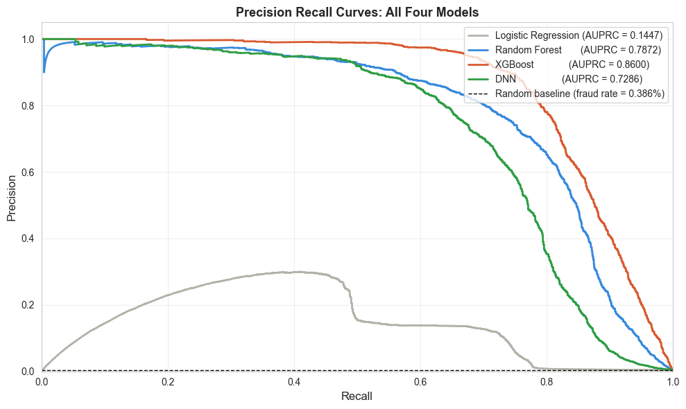

---

## Table of Contents

- [Key Results](#key-results)
- [Questions Explored](#questions-explored)
- [Data](#data)
- [Pipeline](#pipeline)
- [Results in Detail](#results-in-detail)
- [Getting Started](#getting-started)
- [Repository Structure](#repository-structure)
- [Configuration](#configuration)
- [Outputs](#outputs)
- [Limitations](#limitations)
- [Future Work](#future-work)
- [Tech Stack](#tech-stack)
- [Acknowledgements](#acknowledgements)

---

## Key Results

| Model | AUPRC | ROC AUC | F1 | Precision | Recall |
|---|---|---|---|---|---|
| Logistic Regression | 0.1447 | 0.8514 | 0.1616 | 0.0908 | 0.7380 |
| Random Forest | 0.7872 | 0.9895 | 0.7348 | 0.6960 | 0.7781 |
| **XGBoost** | **0.8600** | **0.9955** | **0.7615** | **0.7101** | 0.8210 |
| Deep Neural Network | 0.7286 | 0.9714 | 0.2951 | 0.1784 | **0.8545** |

*Evaluated on the untouched, time-ordered test set (555,719 transactions, 0.386% fraud) at the default 0.5 threshold.*

- **XGBoost is the best model** (AUPRC 0.860), and its lead over every other model is statistically significant (McNemar's test and bootstrap 95% confidence intervals).
- **Threshold tuning matters as much as model choice.** Moving XGBoost's threshold from 0.5 to 0.824 raises F1 from 0.762 to **0.816** and cuts false alerts from 719 to **189**.
- **Transaction amount, merchant category and hour of day** account for 74% of XGBoost's SHAP attribution.
- **Census enrichment did not improve performance.** Withholding the eight socioeconomic features changed mean AUPRC by −0.024 in favour of the model *without* them.
- **Concept drift is present.** Monthly fraud rates range from 1.04% to 0.19% across the 24 months, and ADWIN and DDM both flag drift points in the model's error stream.

---

## Questions Explored

1. How well do traditional ML, ensemble and deep learning models detect fraud under severe class imbalance (≈1 fraud per 171 legitimate transactions)?
2. Does enriching transactions with zip-code-level socioeconomic data (US Census ACS 2019) add predictive value?
3. Which features drive fraud predictions, and in which direction?
4. How should the classification threshold be set when a missed fraud costs far more than a false alert?
5. Does the fraud pattern drift over time, and can drift be detected automatically from the model's errors?

---

## Data

The datasets are **not included** in this repository because of their size. Download them and place all four CSV files in the project root, next to the notebook.

### 1. Sparkov simulated card transactions

- **Source:** [Credit Card Transactions Fraud Detection Dataset (Kaggle)](https://www.kaggle.com/datasets/kartik2112/fraud-detection), generated with the Sparkov Data Generation tool
- **Files:** `fraudTrain.csv`, `fraudTest.csv`
- **Period:** 1 Jan 2019 – 31 Dec 2020 (24 months)

| Split | Rows | Legitimate | Fraud | Fraud rate | Date range |
|---|---|---|---|---|---|
| Train | 1,296,675 | 1,289,169 | 7,506 | 0.579% | 2019-01-01 → 2020-06-21 |
| Test | 555,719 | 553,574 | 2,145 | 0.386% | 2020-06-21 → 2020-12-31 |

The split is **temporal**: every test transaction happens after the last training transaction, which mirrors how a fraud model is deployed in practice.

### 2. US Census American Community Survey (ACS) 2019, 5-year estimates

- **Source:** [data.census.gov](https://data.census.gov/), at ZIP Code Tabulation Area (ZCTA) level
- **Files:**
  - `ACSDP5Y2019.DP05-Data.csv`: demographic and housing estimates (population, age, sex, ethnicity)
  - `ACSST5Y2019.S1901-Data.csv`: household income
- **Coverage:** 33,120 zip codes; all 970 Sparkov zip codes matched (100%)

Nine socioeconomic features are added to every transaction:

| Feature | Census code | Description |
|---|---|---|
| `median_age` | DP05_0018E | Median age of residents |
| `pct_male` / `pct_female` | DP05_0002E / DP05_0003E | Share of male / female residents (derived from counts) |
| `median_household_income` | S1901_C01_012E | Median household income (USD) |
| `pct_hispanic_latino` | DP05_0071PE | % Hispanic or Latino |
| `pct_white` | DP05_0077PE | % White alone, not Hispanic |
| `pct_black` | DP05_0078PE | % Black or African American |
| `pct_native_american` | DP05_0079PE | % American Indian and Alaska Native |
| `pct_asian` | DP05_0080PE | % Asian alone |

### 3. US state boundaries (downloaded automatically)

The geographic maps in Part 2 use a US states GeoJSON file from the [PublicaMundi](https://github.com/PublicaMundi/MappingAPI) repository. It is downloaded once and cached locally as `us-states.json`.

---

## Pipeline

The notebook `Msc_Fraud_Detection_Code.ipynb` runs in seven parts, top to bottom.

### Part 1: Data Enrichment
- Load the Sparkov and Census files and confirm all four inputs exist
- Extract 5-digit zip codes from the Census `GEO_ID` (e.g. `8600000US00601` → `00601`)
- Select and rename the nine Census columns, strip commas from income values, and convert male/female counts to percentages
- Zero-pad Sparkov zip codes (`601` → `00601`) so both sources use the same key
- Left-join the Census data onto the train and test transactions, then verify shape, class balance, value ranges and temporal ordering
- **Output:** `fraudTrain_enriched.csv`, `fraudTest_enriched.csv`

### Part 2: Exploratory Data Analysis
- Class imbalance: 99.42% legitimate vs 0.58% fraud (1 : 171)
- Transaction amounts: fraud mean **$531** vs legitimate mean **$68**
- Fraud rate by merchant category: highest for `shopping_net` (1.76%), `misc_net` (1.45%) and `grocery_pos` (1.41%)
- Fraud rate by gender, by month, and by US state (choropleth and transaction location maps)
- Census feature distributions for fraud vs legitimate transactions
- Correlation heatmap across all numeric features
- Concept drift: monthly fraud rate over the training and test periods

| | |
|---|---|
| 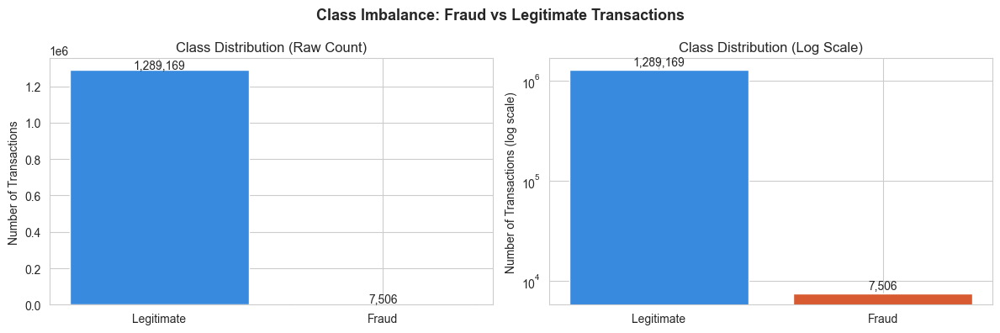 | 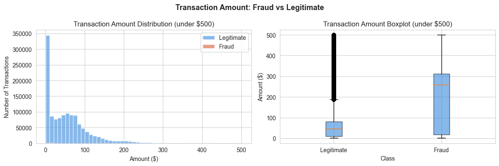 |
| 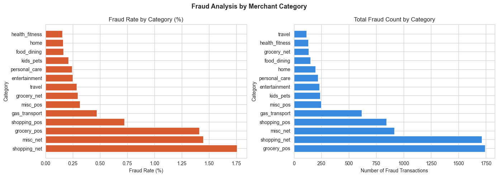 | 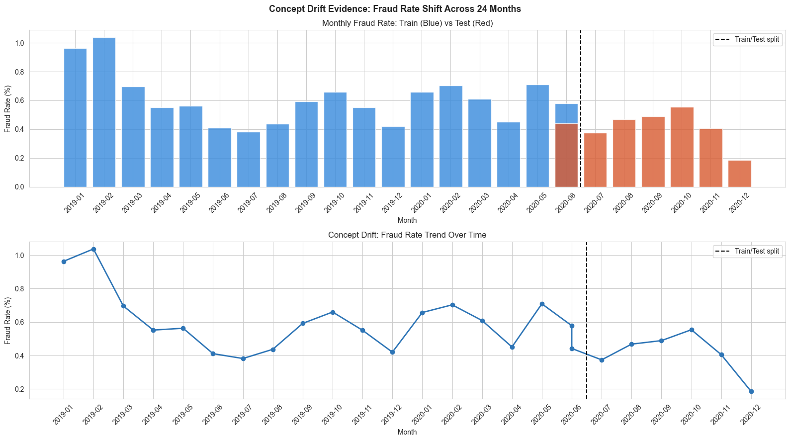 |

### Part 3: Data Preprocessing
- **Drop identifiers:** card number, names, street, transaction ID, unix time
- **Feature engineering:** `trans_hour`, `trans_day`, `trans_month`, `trans_year`, cardholder `age`, and cardholder-to-merchant `distance`
- **Missing values:** median imputation using **training-set medians only** (no test leakage)
- **Encoding:** label-encode `gender`, `category` and `state`; drop high-cardinality `city`, `merchant` and `job`
- **Redundancy removal:** drop `pct_female` (perfectly correlated with `pct_male`), raw coordinates (replaced by `distance`) and `zip`
- **Scaling:** `StandardScaler` fitted on the training set only
- **Class balancing:** SMOTE on the **training set only**, from 7,506 to 1,289,169 fraud rows (50/50). The test set keeps its real-world imbalance.
- **Output:** `train_preprocessed.csv` (2,578,338 rows), `test_preprocessed.csv` (555,719 rows), 19 features each

**Final features (19):** `category`, `amt`, `gender`, `state`, `city_pop`, `median_age`, `pct_male`, `median_household_income`, `pct_hispanic_latino`, `pct_white`, `pct_black`, `pct_native_american`, `pct_asian`, `trans_hour`, `trans_day`, `trans_month`, `trans_year`, `age`, `distance`

### Part 4: Model Training and Evaluation
Every model is tuned on a 100,000-row sample with **AUPRC** as the selection metric, then retrained on the full training set.

| Model | Hyperparameters searched |
|---|---|
| Logistic Regression | `C` ∈ {0.01, 0.1, 1, 10} |
| Random Forest | `n_estimators` ∈ {100, 200}, `max_depth` ∈ {10, 20}, `min_samples_split` ∈ {2, 5} |
| XGBoost | `n_estimators` ∈ {100, 200}, `max_depth` ∈ {4, 6}, `learning_rate` ∈ {0.01, 0.1}, `subsample` = 0.8 |
| DNN | (`learning_rate`, `dropout`) ∈ {(0.001, 0.3), (0.001, 0.4), (0.0005, 0.3)} |

**DNN architecture:** 7 hidden layers (512 → 256 → 128 → 64 → 32 → 16 → 8, ReLU), batch normalisation on the four widest layers, dropout throughout, sigmoid output, Adam optimiser, binary cross-entropy loss, batch size 1,024, up to 50 epochs with early stopping on validation AUC (patience 5).

Evaluation covers:
- AUPRC (primary metric), ROC AUC, F1, precision and recall
- Confusion matrices, precision-recall curves and ROC curves
- **SHAP** (TreeExplainer on XGBoost): global ranking, direction of effect, and local explanations for individual transactions
- **Statistical significance:** pairwise McNemar's tests and bootstrap 95% CIs (2,000 resamples) for AUPRC differences
- **Socioeconomic ablation:** each model retrained with and without the eight Census features

### Part 5: Threshold Optimisation
- Sweep every threshold on XGBoost's precision-recall curve to find the F1-optimal cut-off
- Find the cut-off that minimises total business cost (missed fraud = 100, false alert = 5)

### Part 6: Concept Drift Detection
- Turn XGBoost's predictions on the time-ordered test set into an error stream (1 = wrong, 0 = correct)
- Feed the stream to two detectors from the `river` library:
  - **ADWIN** (Adaptive Windowing): conservative, few false alarms
  - **DDM** (Drift Detection Method): more sensitive to rising error rates

### Part 7: Final Results Summary
Brings together the headline numbers from every part: model comparison, confusion matrix summary, top SHAP features, drift detection, the dataset summary and a list of every chart produced.

---

## Results in Detail

### Model comparison

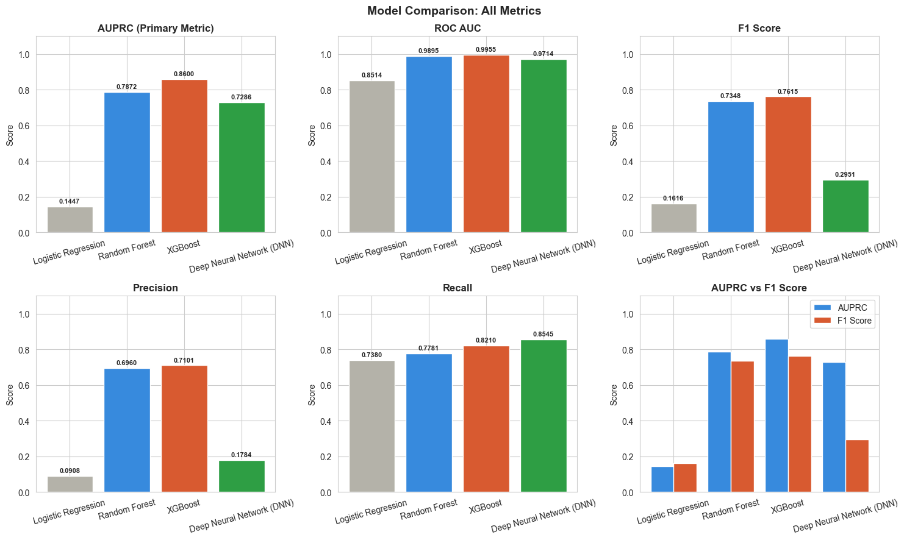

| Model | Fraud caught | Missed | False alerts | Detection rate |
|---|---|---|---|---|
| Logistic Regression | 1,583 | 562 | 15,860 | 73.8% |
| Random Forest | 1,669 | 476 | 729 | 77.8% |
| **XGBoost** | **1,761** | **384** | **719** | **82.1%** |
| DNN | 1,833 | 312 | 8,444 | 85.5% |

The DNN catches the most fraud but raises nearly 12× as many false alerts as XGBoost. Logistic Regression cannot separate the classes well on these features: its AUPRC of 0.145 is far below the tree-based models.

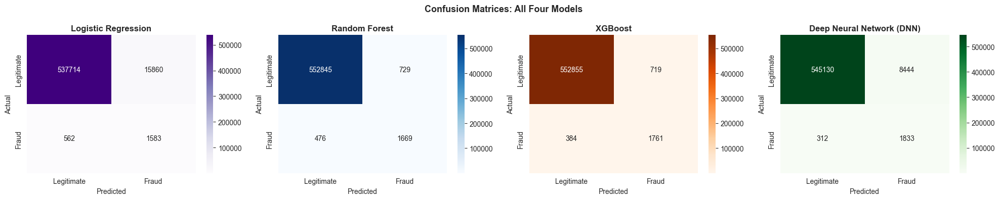

### Statistical significance

All six pairwise McNemar's tests are significant (p < 0.001). Bootstrap 95% confidence intervals for the AUPRC difference against XGBoost all exclude zero:

| Comparison | Mean AUPRC difference | 95% CI |
|---|---|---|
| XGBoost − Logistic Regression | +0.7149 | [0.7034, 0.7261] |
| XGBoost − Random Forest | +0.0726 | [0.0637, 0.0825] |
| XGBoost − DNN | +0.1314 | [0.1193, 0.1436] |

### Feature importance (SHAP, XGBoost)

| Rank | Feature | Mean \|SHAP\| | Share |
|---|---|---|---|
| 1 | `amt` | 2.546 | 35.5% |
| 2 | `category` | 1.678 | 23.4% |
| 3 | `trans_hour` | 1.086 | 15.1% |
| 4 | `trans_day` | 0.456 | 6.3% |
| 5 | `trans_month` | 0.276 | 3.9% |

The top five features account for 84.2% of total attribution. Higher transaction amounts push predictions towards fraud. No Census feature ranks in the top five; the highest is `pct_native_american`, at 6th (2.2%).

| | |
|---|---|
| 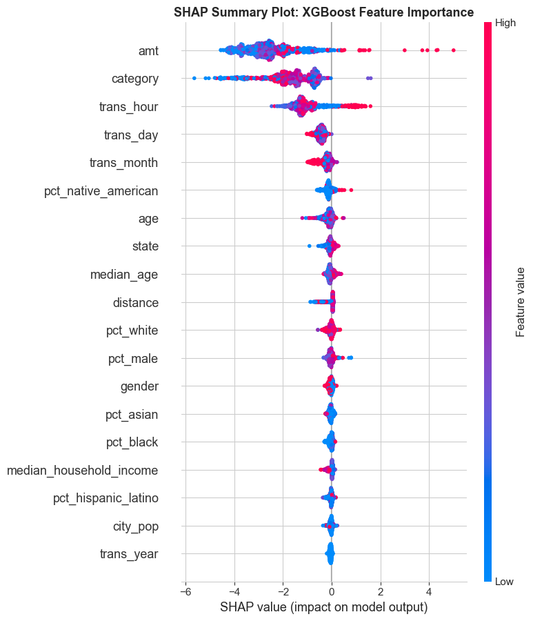 | 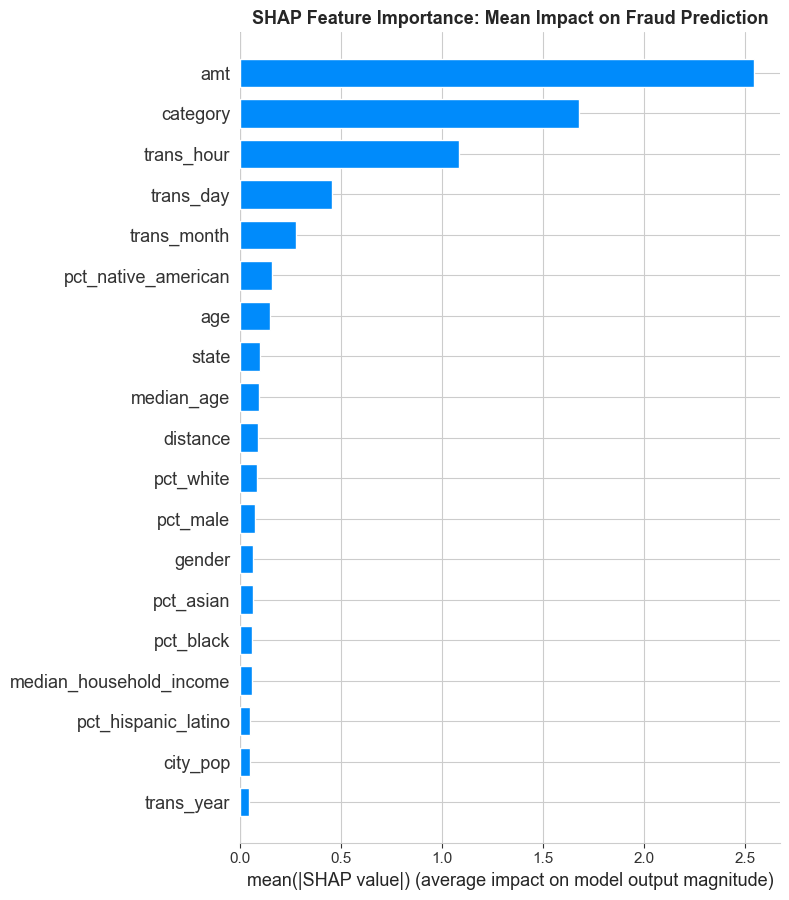 |

### Socioeconomic ablation

| Model | AUPRC without Census | AUPRC with Census | Difference |
|---|---|---|---|
| Logistic Regression | 0.1452 | 0.1450 | −0.0003 |
| Random Forest | 0.8288 | 0.7680 | −0.0609 |
| XGBoost | 0.8578 | 0.8480 | −0.0098 |

Adding the Census features **lowered** mean AUPRC by 0.024, most noticeably for Random Forest. In this dataset, zip-code-level socioeconomic context does not help detect fraud and may add noise. *(Ablation models were trained on 200,000-row samples, so absolute scores differ slightly from the main table.)*

### Threshold optimisation (XGBoost)

| Threshold | Value | Precision | Recall | F1 | Fraud caught | False alerts |
|---|---|---|---|---|---|---|
| Default | 0.500 | 0.710 | 0.821 | 0.762 | 1,761 / 2,145 | 719 |
| **Best F1** | **0.824** | **0.895** | 0.750 | **0.816** | 1,609 / 2,145 | **189** |
| Lowest cost | 0.209 | 0.397 | **0.904** | 0.552 | **1,940 / 2,145** | 2,948 |

Under the cost assumptions (missed fraud = 100, false alert = 5), the cost-optimal threshold lowers total cost from 41,995 to 35,240, a 16% reduction. Which threshold is "best" depends on the business, not only on the model.

| | |
|---|---|
| 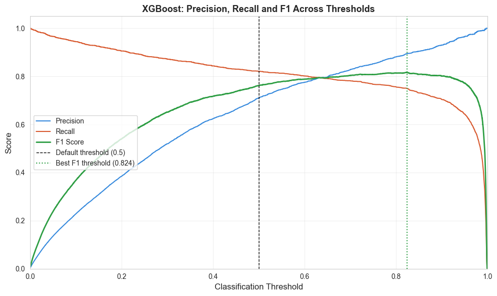 | 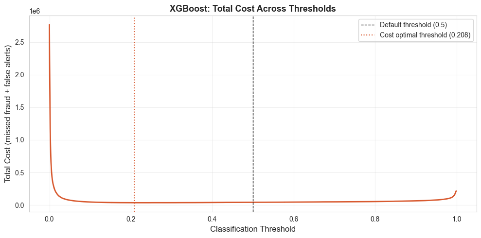 |

### Concept drift

- Monthly fraud rate varies from **1.037%** (Feb 2019) to **0.185%** (Dec 2020)
- The training-period average is 0.609% and the test-period average is 0.417%
- XGBoost's monthly test error rate ranges from 0.114% to 0.280%

| Detector | Drift points | First detection |
|---|---|---|
| ADWIN | 2 | Transaction 282,367 |
| DDM | 25 | Transaction 1,044 |

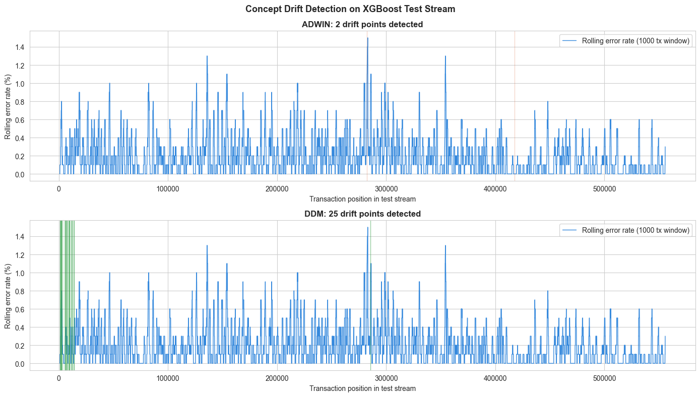

---

## Getting Started

### Requirements

- **Python 3.11–3.13** (developed on Python 3.13)
- **RAM:** 16 GB minimum, 32 GB+ recommended. SMOTE produces a 2.5-million-row training set, and Random Forest, the DNN and SHAP are memory-intensive. A high-RAM machine or HPC is recommended over a standard laptop.

### Installation

```bash
# 1. Clone the repository
git clone https://github.com/GracieDataDiary/card-fraud-detection-concept-drift.git
cd card-fraud-detection-concept-drift

# 2. Create and activate a virtual environment
python -m venv venv
source venv/bin/activate          # Windows: venv\Scripts\activate

# 3. Install the dependencies
pip install -r requirements.txt

# 4. Install river separately, without its dependencies (see note below)
pip install river --no-deps
```

> **Why is `river` installed separately?** `river` requires NumPy ≥ 2.3, but `numba` (needed by SHAP) requires NumPy ≤ 2.2. Installing `river` with `--no-deps` keeps NumPy on a version that works for both. The notebook does the same in its install cell.

### Add the data

Place these four files in the project root:

```
fraudTrain.csv
fraudTest.csv
ACSDP5Y2019.DP05-Data.csv
ACSST5Y2019.S1901-Data.csv
```

### Run

```bash
jupyter notebook Msc_Fraud_Detection_Code.ipynb
```

Run all cells from top to bottom. Cell 1.2 checks that all four input files are present before anything else runs. Parts 1 and 3 save their outputs to CSV, so after a first full run you can restart from Part 2 or Part 4 (after rerunning the Configuration Constants cell). Parts 4–7 share in-memory models and predictions and should be run together.

---

## Repository Structure

```
.
├── Msc_Fraud_Detection_Code.ipynb   # full pipeline (Parts 1–7)
├── images/                          # charts produced by the notebook
├── requirements.txt
├── .gitignore
└── README.md

# Created locally, not tracked by git:
├── fraudTrain.csv / fraudTest.csv                 # raw Sparkov data (download)
├── ACSDP5Y2019.DP05-Data.csv                      # Census demographics (download)
├── ACSST5Y2019.S1901-Data.csv                     # Census income (download)
├── fraudTrain_enriched.csv / fraudTest_enriched.csv   # Part 1 output
├── train_preprocessed.csv / test_preprocessed.csv     # Part 3 output
├── us-states.json                                 # cached GeoJSON
└── chart_*.png                                    # charts saved by each run
```

---

## Configuration

All pipeline settings live in one **Configuration Constants** cell at the top of the notebook:

| Constant | Default | Purpose |
|---|---|---|
| `RANDOM_STATE` | 42 | Seed used everywhere for reproducibility |
| `HYPERPARAM_SAMPLE_SIZE` | 100,000 | Rows used for hyperparameter tuning |
| `SHAP_SAMPLE_SIZE` | 1,000 | Test rows used to compute SHAP values |
| `DEFAULT_THRESHOLD` | 0.5 | Default classification cut-off |
| `COST_PER_MISSED_FRAUD` | 100 | Relative cost of a false negative |
| `COST_PER_FALSE_ALERT` | 5 | Relative cost of a false positive |
| `CHART_DPI` | 150 | Resolution of saved charts |
| `AMOUNT_DISPLAY_CAP` | 500 | Amount cap for histograms (display only) |

---

## Outputs

Running the notebook saves these charts to the project root (copies are in [`images/`](images/)):

| EDA | Modelling | Explainability & drift |
|---|---|---|
| `chart_class_imbalance.png` | `chart_model_comparison.png` | `chart_shap_summary.png` |
| `chart_amount_analysis.png` | `chart_confusion_matrices.png` | `chart_shap_importance.png` |
| `chart_fraud_by_category.png` | `chart_precision_recall_curves.png` | `chart_shap_dependence.png` |
| `chart_fraud_by_gender.png` | `chart_roc_curves.png` | `chart_shap_local.png` |
| `chart_temporal_analysis.png` | `chart_census_ablation.png` | `chart_threshold_optimisation.png` |
| `chart_census_distributions.png` | | `chart_threshold_cost.png` |
| `chart_correlation_heatmap.png` | | `chart_drift_detection.png` |
| `chart_fraud_rate_by_state.png` | | |
| `chart_transaction_locations.png` | | |
| `chart_concept_drift.png` | | |

---

## Limitations

- **Simulated data:** Sparkov transactions are synthetic. Fraud patterns, and how they drift, may be simpler or more regular than in real card networks.
- **Zip-level enrichment is coarse:** Census features describe an area, not the cardholder, which may explain why they add no predictive value.
- **SMOTE on 2.5M rows:** synthetic minority samples may not reflect real fraud behaviour, and they inflate training cost.
- **Sampled tuning:** hyperparameters were tuned on a 100k sample, and SHAP was computed on 1,000 test rows. Results on the full data may differ slightly.
- **Illustrative costs:** the 100 : 5 cost ratio is an assumption, not a real business figure.
- **Drift is detected, not handled:** the pipeline identifies drift but does not retrain or adapt the model in response.

## Future Work

- Adaptive or online learning that retrains when ADWIN/DDM signal drift
- Rolling or expanding-window evaluation across the 24 months
- Alternatives to SMOTE (class weights, focal loss, undersampling ensembles)
- Behavioural features such as transaction velocity and per-card spending profiles
- Validation on a real-world transaction dataset

---

## Tech Stack

**Python** · pandas · NumPy · scikit-learn · imbalanced-learn (SMOTE) · XGBoost · TensorFlow / Keras · SHAP · river (ADWIN, DDM) · SciPy · Matplotlib · Seaborn · Jupyter

## Acknowledgements

- Transaction data: Sparkov Data Generation, via the Kaggle *Credit Card Transactions Fraud Detection Dataset*
- Socioeconomic data: U.S. Census Bureau, American Community Survey 2019 5-Year Estimates
- State boundaries: PublicaMundi `us-states.json`
